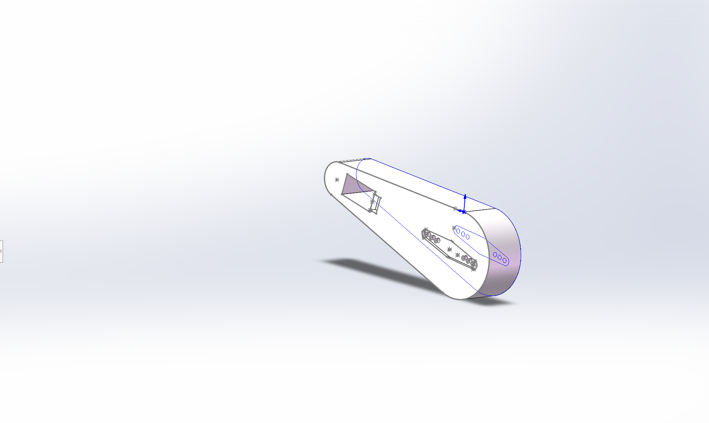
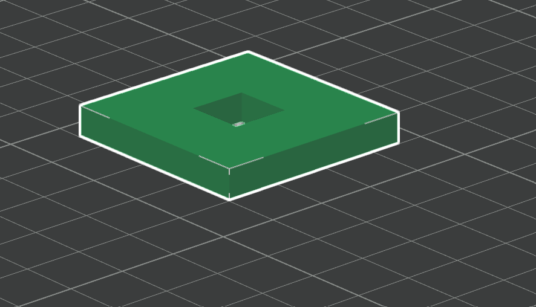
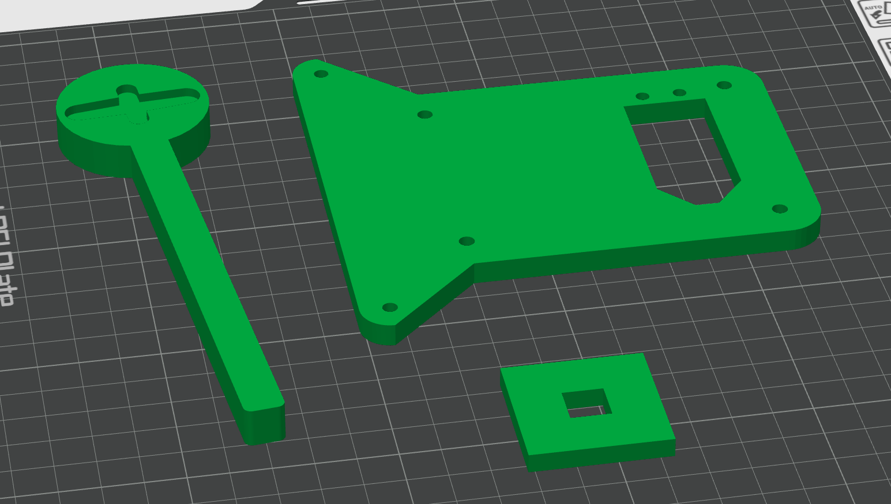

# 01 机械 - 3D 建模与结构设计

> 培训所学 + 项目建模实录。

## 建模软件学习

第一周熟悉三维建模软件（Fusion360 / SolidWorks）的基础操作：草图绘制 → 尺寸约束 → 拉伸/切除成体 → 倒角圆角 → 装配体配合。

## 建模实录：从草图到零件

长臂的草图与实体建模过程——先画轮廓草图并约束尺寸，再拉伸成体，最后添加电机安装孔与减重孔位：

比赛方块（30mm 立方体）的参照模型，用于校核长臂与机构的配合尺寸：

## 3D 打印流程体验

第二周体验了从模型到实物的完整流程：导出 STL → 切片（摆 orientation、加支撑、设层厚/填充）→ 打印。第一版零件（小臂、挡板、第二层支架）切片预览：

## 结构设计要点

- **先整车建模再设计零件**——我们第一版因未做整车建模导致结构干涉，教训深刻；
- **公差配合**——3D 打印孔位存在收缩偏差，螺丝孔要预留余量（我们靠铜柱倾斜装配救场）；
- **强度与重量平衡**——选 PETG 材料，在减重的同时保证打印件强度足够应对比赛。
