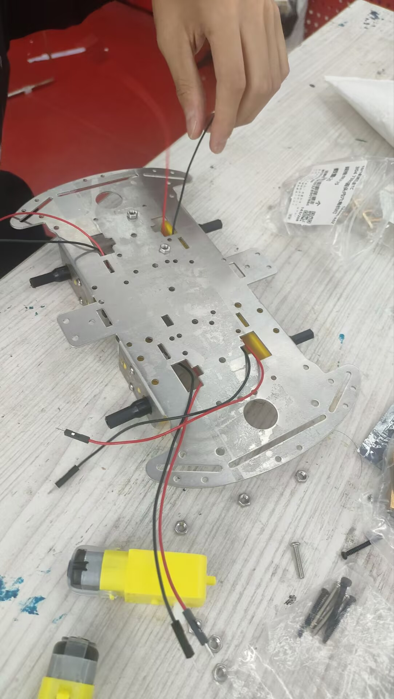
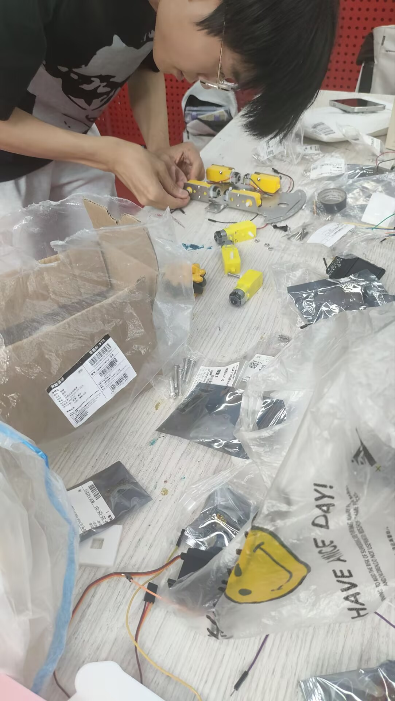

# 02 底盘搭建

> 对应时间：第二周（建模并体验 3D 打印）

## 底盘搭建

### 功能描述

底盘是整台机器人的承载与移动基础，负责支撑抬升机结构并实现四轮移动。本阶段完成底盘的整体建模与装配方案设计。

### 设计思路

- 底盘采用四轮驱动，承载抬升机结构与电控系统；
- 通过 Fusion360 完成底盘的 3D 建模，并进行 3D 打印验证；
- 机架兼顾强度与轻量，控制整车重量在合规范围内。

### 开发历程

1. **第一周**：熟悉工作软件（Fusion360 等建模工具），完成基础操作学习；
2. **第二周**：开始底盘建模，并体验 3D 打印流程，验证零件可打印性与装配配合。

### 最终实现

- 底盘完成建模并通过 3D 打印出样件；
- 尺寸、重量均控制在合规范围内。

### 迭代记录

（待补充：v1 → v2 改进，如打印件配合、强度问题）

### 效果验证

底盘机架与电机接线实物：

电机安装装配过程：

