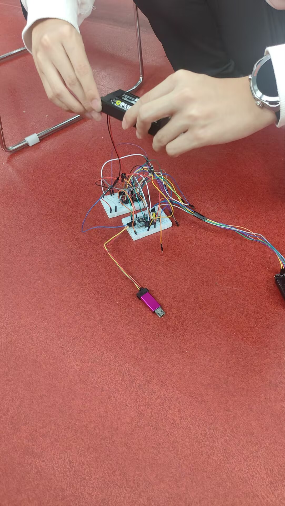
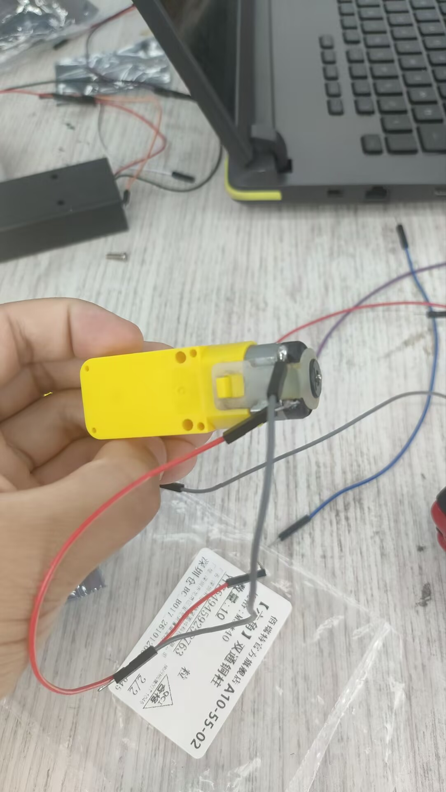
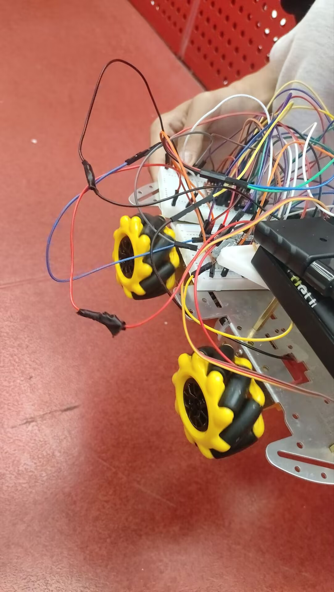

# 03 基础运动控制

> 对应时间：第三周（购买材料、编写代码、调参数）

## 基础运动控制

### 功能描述

实现机器人四轮的基础运动控制，通过 PS2 手柄遥控四轮转动，完成前进、后退、转向与自旋等基础动作。

### 实现方案

- **控制方式**：PS2 手柄无线遥控，解析摇杆 / 按键输入映射到四轮转速；
- **电机驱动**：四路电机分别驱动，实现差速转向（普通轮）或全向移动（麦轮）；
- **参数调试**：本阶段完成代码编写与关键参数（死区、加减速、摇杆曲线）的调试。

### 开发历程

1. **第三周**：购买材料后开始编写控制代码；
2. 完成 PS2 手柄通信、四轮驱动的基础代码框架；
3. 反复调试控制参数，使运动平稳、响应符合操作习惯。

### 踩坑记录

（待补充：调试中遇到的 bug，如电机抖动、手柄掉线、共地问题等，及定位与解决方法）

### 最终实现

- PS2 手柄控制四轮转动，基础运动稳定；
- 控制参数调优完成，运动手感良好。

### 迭代记录

（待补充：死区 / 加减速 / 摇杆曲线调了几轮，为什么调）

### 效果验证

面包板电路调试（主控 + 驱动 + PS2 接收器接线）：

TT 减速电机（四轮驱动单元）：

整车装配与走线（轮系 + 电控上车）：

