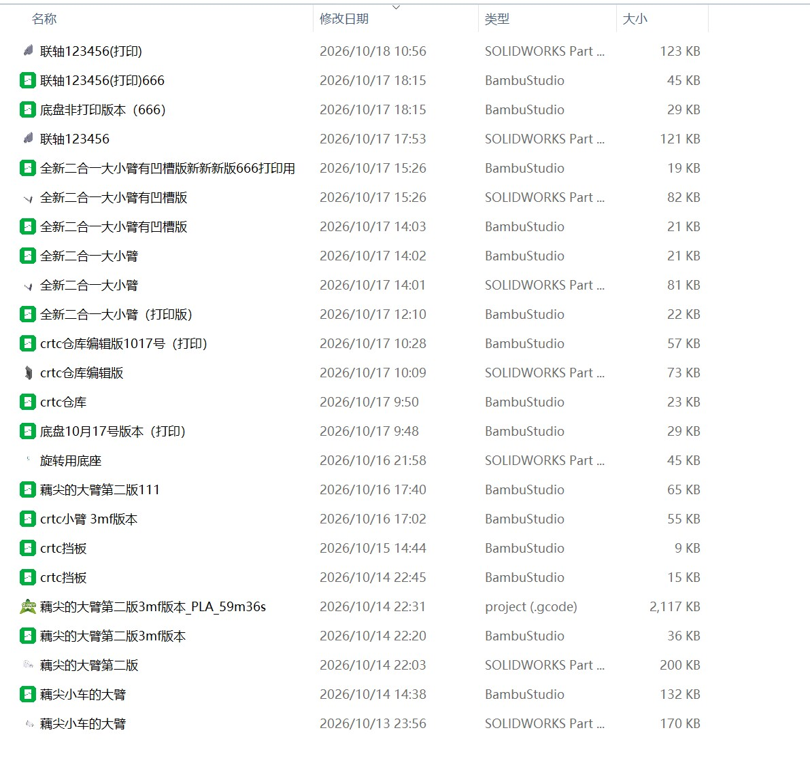

# 05 机电联调与迭代

> 对应时间：第四周（组装实操）

## 机电联调

### 功能描述

将机械结构与电控系统整合，完成整机的组装与联调，使底盘移动与方块串取抬升机构协同工作，实现"行进 → 串取 → 抬升携带 → 释放"的完整动作流程。

### 开发历程

1. 第四周开始组装实操，将各 3D 打印件与电控器件装配到机架上；
2. 完成机械与电控的联合调试；
3. 反复测试整机动作，修正机构与参数，直至动作稳定。

### 踩坑记录（公差 / 配合问题）

- **问题**：由于公差及测量螺丝孔位存在误差，导致**铜柱无法在竖直状态下支撑**对应部件。
- **解决**：让铜柱**略微倾斜**，即可完成连接并提供支撑，同时不影响整体强度。

（待补充：其他联调问题，如共地、上电时序、跌落测试等）

### 最终实现

- 整机组装完成，尺寸重量合规；
- 机电联调通过，方块串取抬升携带功能稳定运行。

### 迭代记录

零件迭代版本时间线（建模文件与打印工程按时间排列，可以看到完整的迭代脉络）：

从版本时间线可以读出整个迭代过程：

| 日期 | 版本 | 迭代内容 |
|---|---|---|
| 10-13 | 藕尖小车的大臂 | 初版大臂建模 |
| 10-14 | 藕尖的大臂第二版 → 3mf 版本 → 打印 gcode | 大臂结构改进并首次打印（打印耗时 59 分钟） |
| 10-14 ~ 10-15 | crtc 挡板 | 挡板两版迭代 |
| 10-16 | crtc 小臂 3m 版本、藕尖的大臂第二版 111、旋转用底座 | 小臂改进、大臂再修正、尝试旋转底座方案 |
| 10-17 | 底盘 10 月 17 号版本、crtc 仓库及编辑版 1017 号 | 底盘更新、整车装配文件整理 |
| 10-17 | 全新二合一大大小臂（→ 有凹槽版 → 打印版） | **方案重构**：大小臂合并为二合一结构，并增加电机凹槽 |
| 10-17 ~ 10-18 | 联轴 123456（→ 打印版） | 联轴最终版，底部带螺纹孔与底盘连接 |

其中"全新二合一大大小臂有凹槽版"正对应 04 文档中提到的长臂迭代——把大小臂合并、增加连接电机的凹槽，是干涉问题重构后的关键版本。

### 效果验证

（待补充：整机照片 / 演示视频截图 / 数据）
